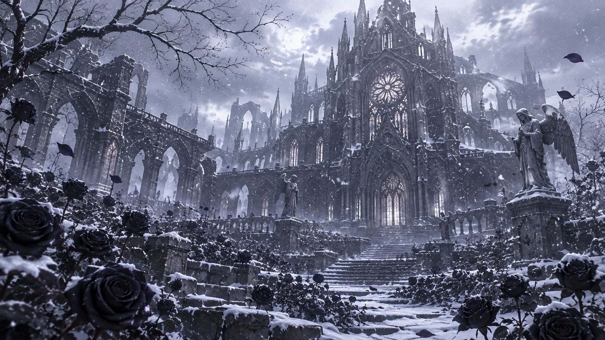
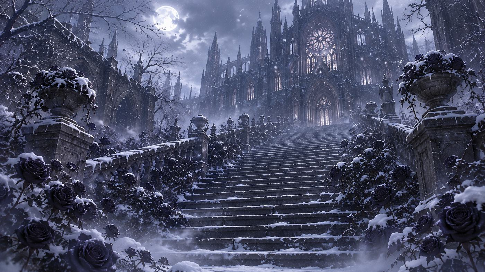
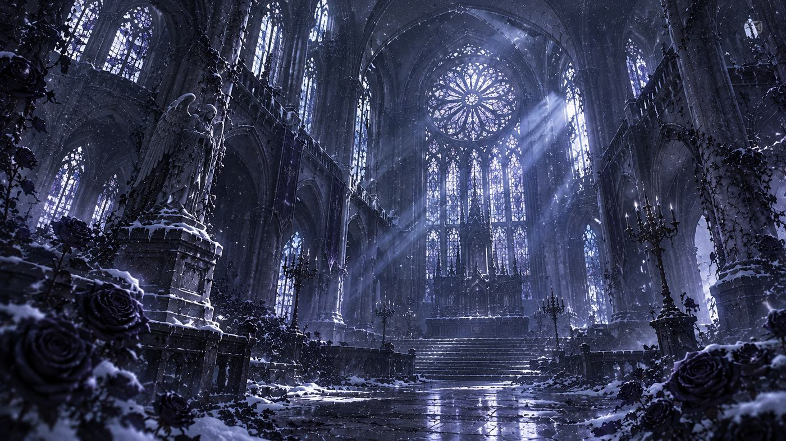
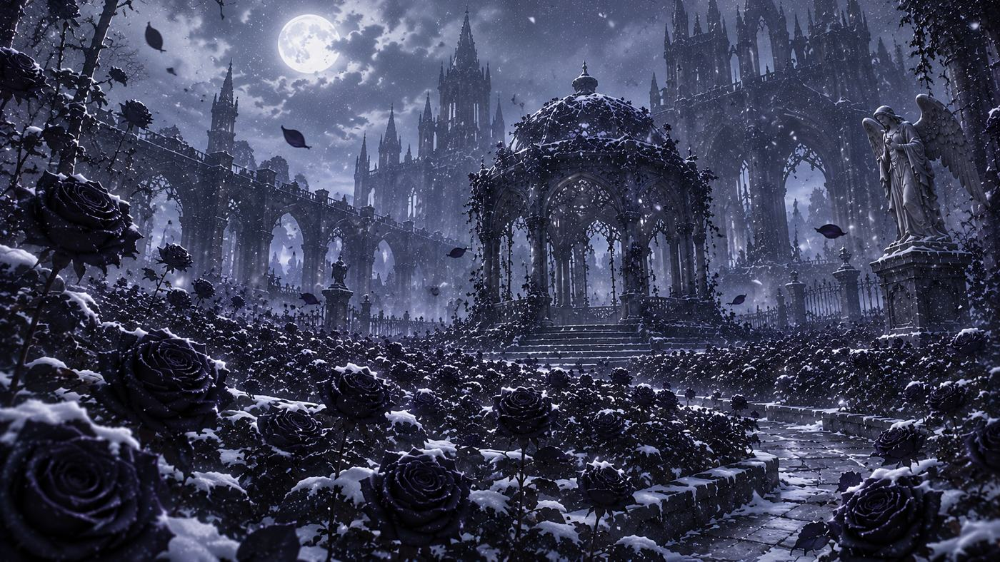
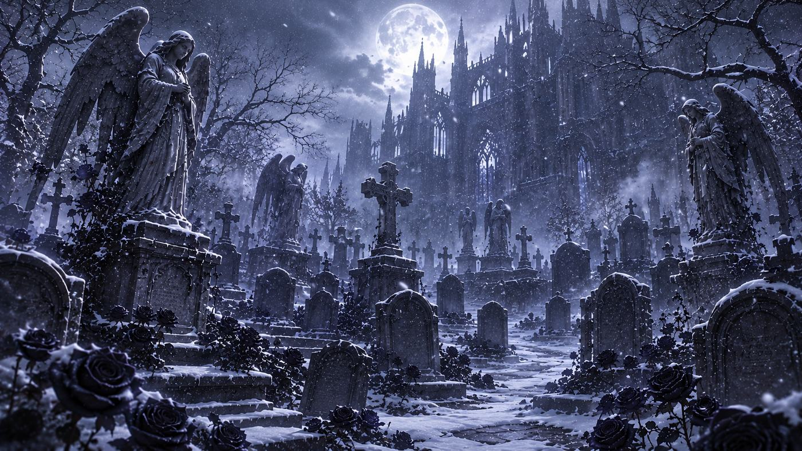
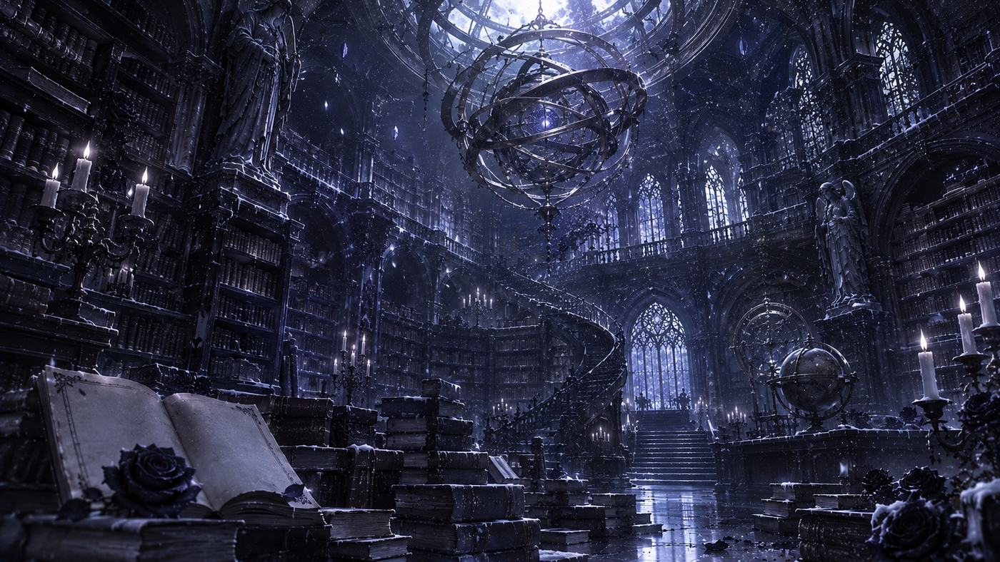
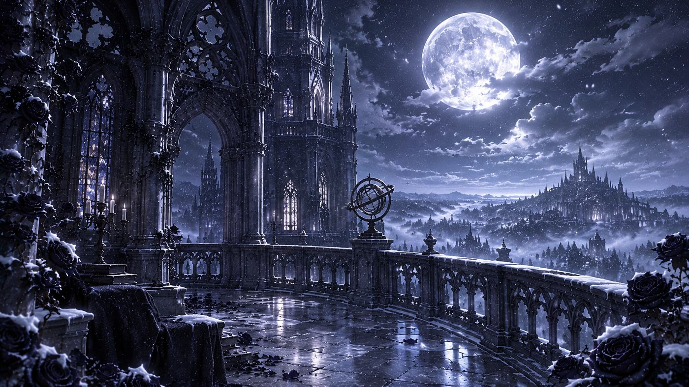

# 🥀 วิหารกุหลาบนิทรา

*The Cathedral of Sleeping Roses*

**สถานที่ลึกลับระหว่างความฝันและความเป็นจริง**

> พื้นที่พิเศษ ใช้เวทมนตร์ได้

ไม่มีใครรู้ว่าวิหารถูกสร้างขึ้นเมื่อใด เหลือเพียงอาคารหินโบราณ สวนกุหลาบสีดำ และหิมะที่ตกไม่รู้จบ

วิหารกุหลาบนิทราไม่ปรากฏบนแผนที่ทั่วไป ไม่มีอาณาเขตแน่นอน และเครื่องมือบอกทิศธรรมดาไม่อาจชี้ตำแหน่งได้อย่างน่าเชื่อถือ

กล่าวกันว่ามันตั้งอยู่ตรงรอยต่อของโลกแห่งความฝันกับโลกจริง ฤดูกาลไม่เคยเปลี่ยน เวลาเคลื่อนช้า และความเงียบกลายเป็นส่วนหนึ่งของธรรมชาติ

## ข้อมูลพื้นที่

| หัวข้อ | รายละเอียด |
|---|---|
| **ประเภท** | พื้นที่พิเศษ ดินแดนกึ่งความฝัน |
| **ที่ตั้ง** | ไม่ปรากฏบนแผนที่ อยู่ที่รอยต่อระหว่างความฝันกับความจริง |
| **เวทมนตร์** | ใช้ได้ |
| **ฤดูกาล** | ฤดูหนาวตลอดกาล หิมะไม่ละลายตามธรรมชาติ |
| **ท้องฟ้า** | กลางคืนหรือพลบค่ำ ดวงจันทร์ใหญ่เหนือยอดวิหาร |
| **แหล่งแสง** | แสงจันทร์ แสงเทียน และแสงผ่านกระจกสี |
| **พืชเด่น** | กุหลาบสีดำ เถาวัลย์หนาม ต้นไม้ไร้ใบ |
| **สถาปัตยกรรม** | โกธิก หินเทาเข้มเกือบดำ ซากวิหารโบราณ |
| **ท่าทีของที่นี่** | ไม่เป็นมิตรและไม่เป็นศัตรู เพียงคงอยู่ในความเงียบของตนเอง |
| **สีประจำพื้นที่** | ขาวหิมะ, ดำกุหลาบ, เทาหิน, เงินจันทร์, น้ำเงินหม่น |

## เมื่อก้าวเข้ามา

ความงดงาม ความสงบ และความโดดเดี่ยว อยู่ร่วมกันในที่เดียว

### 👁️ สิ่งที่เห็น

ยอดหอคอยสูงตั้งตระหง่านเหนือม่านหมอกและต้นไม้สีดำ กลีบกุหลาบที่ร่วงบนหิมะดูเหมือนเศษกระดาษที่ฉีกจากหนังสือ

### 👂 สิ่งที่ได้ยิน

ลมผ่านซุ้มประตู หิมะบนหลังคา กลีบกุหลาบเสียดสีกัน เสียงฝีเท้าสะท้อนในโถง แต่ไม่เคยมีเสียงระฆัง

### 🌫️ สิ่งที่รู้สึก

หนาวสม่ำเสมอแต่ไม่รุนแรงจนอยู่ไม่ได้ หมอกขาวเทาลอยเหนือสวน ลานหิน และสุสาน

### 🌹 กลิ่น

หิมะเย็น หินเก่า ไม้แห้ง กุหลาบดำมีกลิ่นคล้ายดอกไม้แห้งปนกระดาษเก่า หอสมุดมีกลิ่นหมึก สุสานมีกลิ่นดินเย็น

### 🌙 แสง

จันทร์สีเงินในที่โล่ง เทียนและตะเกียงตามทางเดิน เศษกระจกสีทอดแสงม่วง น้ำเงิน และแดงเข้มบนพื้นหิน

### ✨ ร่องรอยเวทมนตร์

ไม่รุนแรง แต่แทรกในสิ่งธรรมดา เช่น กลีบกุหลาบทวนลม ประตูที่ดูใกล้กว่าจริง ทางเดินที่ทำให้รู้สึกว่าผ่านที่เดิมซ้ำ

## จุดน่าสนใจ

เลือกสำรวจจุดไหนก่อนก็ได้ ไม่ต้องเรียงลำดับ

### 🥀 บันไดแห่งการหลับใหล
*The Sleeping Stairway*

**ป้ายกำกับ:** ทางเข้าหลัก

บันไดหินขนาดใหญ่ทอดขึ้นสู่เขตวิหารหลัก มีซุ้มประตูโกธิกตรงทางขึ้น สองข้างเต็มไปด้วยกุหลาบสีดำที่เลื้อยพันราวหินและเสาเก่าแก่

หิมะปกคลุมพื้นบันไดเป็นบางส่วน จึงต้องระวังขณะเดิน

**สิ่งที่อาจพบ**

- กลีบกุหลาบสีดำตกอยู่ตามขั้นบันได
- รอยเท้าบนหิมะที่ระบุไม่ได้ว่าเป็นของใคร

### ⛪ มหาวิหารแห่งความเงียบ
*The Silent Cathedral*

**ป้ายกำกับ:** โถงหลัก

โถงใหญ่ที่มีเพดานสูงและเสาหินเรียงยาว หน้าต่างกระจกสีทอดตัวขึ้นเกือบถึงเพดาน แสงจันทร์ลอดผ่านลงมาเป็นลวดลายหลากสีบนพื้นหิน

ภายในมีม้านั่งไม้เก่า แท่นพิธี และรูปสลักเทวทูตตามแนวเสา ไม่มีเสียงระฆังหรือเสียงสวดมนต์เหลืออยู่ แม้จะมีหอระฆังอยู่เหนืออาคาร

**สิ่งที่อาจพบ**

- ลวดลายแสงสีบนพื้นหิน
- รูปสลักเทวทูตตามแนวเสา
- ความเงียบของหอระฆัง

### 🌹 สวนกุหลาบสีดำ
*The Black Rose Garden*

**ป้ายกำกับ:** เหมาะแก่การพักผ่อน

สวนกว้างที่เต็มไปด้วยกุหลาบสีดำสนิท ล้อมศาลาโกธิกกลางสวน และเชื่อมกับทางเดินหินหลายสาย กุหลาบยังบานแม้ท่ามกลางหิมะ

มีม้านั่งหินตามมุมสวน เหมาะแก่การพักผ่อน อ่านหนังสือ หรือนั่งสังเกตบรรยากาศ

**สิ่งที่อาจพบ**

- กลีบดอกที่ลอยขึ้นจากพื้นและเคลื่อนไปตามลมโดยไม่มีที่มา
- เถาวัลย์หนามที่เลื้อยพันรูปปั้นและซุ้มประตู

### 🪦 สุสานไร้นาม
*The Nameless Cemetery*

**ป้ายกำกับ:** หลังวิหาร

สุสานเก่าแก่ด้านหลังวิหาร ป้ายหลุมศพเรียงรายท่ามกลางหิมะ แต่ไม่มีชื่อผู้ตายสลักอยู่เลยสักป้าย

รูปปั้นเทวทูตหินยืนเฝ้าตามจุดต่าง ๆ บางรูปมีปีกสมบูรณ์ บางรูปเหลือเพียงโครงปีกที่แตกหัก

**สิ่งที่อาจพบ**

- กุหลาบสีดำที่วางหน้าหลุมศพทุกแห่ง โดยไม่ทราบว่าใครนำมาวาง
- กลิ่นดินเย็นและหินเปียกน้ำค้าง

### 📚 หอสมุดนิทรา
*The Library of Slumber*

**ป้ายกำกับ:** ห้องสมุดใต้ดิน · เหมาะแก่การค้นคว้า

ห้องสมุดใต้ดินขนาดใหญ่ ชั้นไม้สูงจรดเพดานเต็มไปด้วยหนังสือเก่า มีบันไดวนและระเบียงเชื่อมแต่ละชั้น ใจกลางห้องมีโต๊ะอ่านหนังสือขนาดใหญ่ พร้อมโคมไฟและเก้าอี้เก่า

หนังสือบางเล่มบันทึกเรื่องที่ไม่มีใครจำได้ บางเล่มมีเพียงชื่อผู้เขียนกับหน้าว่าง และบางเล่มมีข้อความที่ดูเหมือนเปลี่ยนไปเมื่อกลับมาอ่านอีกครั้ง

**สิ่งที่อาจพบ**

- กลิ่นหมึกและหนังสือโบราณ
- หน้ากระดาษที่พลิกเอง

### 🌙 หอคอยแห่งดวงจันทร์
*The Moonlit Tower*

**ป้ายกำกับ:** จุดชมวิว · เงียบสงบที่สุด

หอคอยที่สูงที่สุดของวิหาร มีบันไดวนขึ้นสู่ระเบียงเปิดโล่ง มองเห็นทั้งสวนกุหลาบ สุสาน แนวป่า และภูมิประเทศที่อยู่ไกลออกไป

ราวหินแกะสลักและเสาโกธิกประดับเถากุหลาบ แสงจันทร์ส่องลงบนพื้นหินที่มักมีหิมะบาง ๆ

**สิ่งที่อาจพบ**

- เสียงระฆังที่เล่ากันว่าดังบางคืน ทั้งที่ไม่มีใครเคยพบระฆังที่สมบูรณ์

### 🪞 ห้องโถงกระจกเงา
*The Hall of Silent Mirrors*

**ป้ายกำกับ:** ห้องโถงยาว

ห้องโถงยาวที่มีกระจกโบราณติดตามผนังทั้งสองด้าน กรอบทำจากโลหะสีเงินหม่น แกะสลักลายกุหลาบตามขอบ

กระจกส่วนใหญ่สะท้อนภาพตามปกติ แต่บางบานอาจสะท้อนรายละเอียดที่ต่างออกไป เช่น แสงไฟที่ไม่มีอยู่จริง หรือเงาของวัตถุที่ไม่ปรากฏในห้อง

**สิ่งที่อาจพบ**

- เงาสะท้อนที่คลาดเคลื่อนเล็กน้อย

### 🕰️ ห้องนาฬิกาที่หยุดนิ่ง
*The Frozen Clock Chamber*

**ป้ายกำกับ:** ห้องเก็บของเก่า

ห้องเก็บนาฬิกาเก่าหลายแบบ ทั้งนาฬิกาตั้งพื้น นาฬิกาแขวน และนาฬิกากลไกขนาดใหญ่ บางเรือนหยุดที่เที่ยงคืน บางเรือนหยุดในเวลาอื่นโดยไม่มีรูปแบบร่วมกัน

เสียงกลไกบางส่วนยังดังเป็นระยะ แม้ลูกตุ้มจะหยุดเคลื่อนไหวไปแล้ว

**สิ่งที่อาจพบ**

- เสียงกลไกที่ดังทั้งที่ลูกตุ้มไม่ขยับ

### 🕊️ ระเบียงเทวทูต
*The Angel's Gallery*

**ป้ายกำกับ:** ลมแรงกว่าที่อื่นเล็กน้อย

ระเบียงหินที่เชื่อมกับส่วนบนของมหาวิหาร มีรูปปั้นเทวทูตเรียงตามแนวกำแพง บางรูปมองลงสู่สวน บางรูปก้มหน้าประสานมือราวกับภาวนา

หิมะมักเกาะตามปีกและไหล่ของรูปปั้น และมองเห็นยอดหอคอยได้ชัดจากมุมใกล้

**สิ่งที่อาจพบ**

- เงาคล้ายปีกบนหน้าต่างกระจกสี
- เงาของรูปปั้นที่ทอดผิดทิศ

### 🗝️ ห้องใต้ดินไร้แสง
*The Lightless Crypt*

**ป้ายกำกับ:** ต้องผ่านการพิจารณาของ GM

พื้นที่ใต้ส่วนเก่าของวิหาร มีทางเดินหินแคบและประตูเหล็กเก่าหลายบาน บางห้องมีชั้นเก็บของและกล่องไม้ที่ถูกทิ้งไว้นาน

ภายในมืดกว่าที่อื่นอย่างเห็นได้ชัด แสงจากภายนอกแทบส่องไม่ถึง ผนังบางส่วนมีสัญลักษณ์และรอยสลักที่ยังไม่รู้ความหมาย

**สิ่งที่อาจพบ**

- สัญลักษณ์เก่าแก่บนผนัง

## เสียงกระซิบ

ข่าวลือยังไม่มีหลักฐานยืนยัน อาจเป็นเพียงเรื่องเล่าจากบรรยากาศของสถานที่

> มีคนกล่าวว่า หากเดินขึ้นบันไดแห่งการหลับใหลในช่วงที่หิมะตกหนัก จะพบรอยเท้าอีกคู่เดินอยู่ข้าง ๆ แม้จะไม่มีใครเดินตามมา

> บางคนเคยเห็นแสงไฟในหน้าต่างของหอสมุดนิทรา ทั้งที่อาคารส่วนนั้นถูกปิดตายมานานแล้ว

> ว่ากันว่ากุหลาบดำในสวนจะไม่ร่วงพร้อมกันสองดอก หากมีใครเด็ดไปหนึ่งดอก ดอกอื่นจะยังอยู่บนกิ่งเสมอ

> ผู้ที่เข้าไปในห้องโถงกระจกเงาอาจพบเงาสะท้อนของตนกำลังยิ้ม ทั้งที่เจ้าตัวไม่ได้ยิ้มเลย

> มีผู้พบว่ารูปปั้นเทวทูตในสุสานเปลี่ยนท่าทางเล็กน้อยเมื่อกลับมาเยือนอีกครั้ง แต่ไม่มีใครยืนยันได้ว่าเดิมมันอยู่ท่าไหน

> บางคืนมีเสียงระฆังดังจากหอคอยแห่งดวงจันทร์ แม้จะไม่มีใครเคยพบระฆังที่ยังสมบูรณ์

> มีหนังสือเล่มหนึ่งในหอสมุดนิทราที่ไม่มีชื่อผู้เขียน แต่บนปกมีชื่อของผู้ที่กำลังอ่านมันอยู่

> บางคนเชื่อว่า หากนั่งในสวนกุหลาบสีดำจนถึงรุ่งเช้า จะพบว่าหิมะรอบตัวไม่เคยมีรอยเท้าของตนเอง

## ปรากฏการณ์ที่พบได้ทั่วไป

- 🌨️ หิมะตกต่อเนื่องโดยไม่มีทิศทางลมแน่นอน
- 🥀 กลีบกุหลาบสีดำลอยทวนกระแสลม
- 🌙 แสงจันทร์ส่องผ่านเมฆ แม้ท้องฟ้าจะมืดครึ้ม
- 🕯️ เปลวเทียนสั่นไหวโดยไม่มีลมพัด
- 🪞 เงาสะท้อนในกระจกคลาดเคลื่อนเล็กน้อย
- 🕰️ เสียงกลไกนาฬิกาดังจากห้องที่ไม่มีนาฬิกาทำงาน
- 📖 หน้ากระดาษในหนังสือบางเล่มพลิกเอง
- 🪦 กลีบกุหลาบปรากฏบนหลุมศพที่ไม่มีผู้มาเยือน
- 🌫️ หมอกสีขาวเคลื่อนผ่านพื้นหินและทางเดิน
- ❄️ เกล็ดหิมะบางส่วนหยุดนิ่งกลางอากาศชั่วครู่
- 🕊️ เงาคล้ายปีกปรากฏบนหน้าต่างกระจกสี
- 🎵 เสียงดนตรีแผ่วเบาดังมาจากห้องที่ว่างเปล่า
- 🌑 เงาของรูปปั้นทอดยาวผิดทิศทาง
- 💠 ผลึกน้ำแข็งสะท้อนแสงสีม่วงจาง ๆ
- 🌹 ดอกกุหลาบบางดอกมีหยดน้ำค้างสีเงินเกาะอยู่

เป็นเพียงบรรยากาศประจำพื้นที่ ไม่ถือเป็นหลักฐานว่ามีสิ่งมีชีวิตหรือวัตถุพิเศษซ่อนอยู่ และผู้เล่นไม่สามารถจับหรือครอบครองได้โดยอัตโนมัติ

## แนวทางการโรลเพลย์

ใช้เวทมนตร์ตามความเหมาะสมของตัวละคร และเลือกเส้นทางที่อยากเดินได้อย่างอิสระ

### 🥾 สำรวจ

- บันไดหินและทางเดินรอบวิหาร
- สุสานและรูปปั้นเทวทูต
- ห้องโถงและแหล่งกำเนิดแสง
- ประตูและห้องใต้ดินที่ยังเข้าไม่ถึง

### 📚 ค้นคว้า

- อ่านหนังสือในหอสมุดนิทรา
- สังเกตความผิดปกติของกระจกเงา
- ตรวจสอบนาฬิกาและกลไกโบราณ
- ศึกษาสถาปัตยกรรมและลวดลายแกะสลัก

### 🪑 ใช้เวลา

- พักผ่อนในสวนหรือในวิหาร
- ชมทิวทัศน์จากหอคอยแห่งดวงจันทร์
- สังเกตการเปลี่ยนแปลงของหิมะและอากาศ
- บันทึกปรากฏการณ์และเรื่องราวที่พบเห็น

### 🤝 พบปะ

- แลกเปลี่ยนข้อมูลกับผู้มาเยือนคนอื่น
- ตรวจสอบกุหลาบสีดำและเถาวัลย์หนามไปพร้อมกัน
- เปิดพื้นที่ให้ตัวละครอื่นตอบสนองด้วยตนเอง

## กฎของพื้นที่

### ควรทำ

- คำนึงถึงสภาพแวดล้อม เช่น พื้นหินลื่น หิมะ หมอก ทัศนวิสัย และความสูงของอาคาร
- เคารพพื้นที่โรลเพลย์ของผู้เล่นอื่น และเปิดโอกาสให้ตัวละครแต่ละคนตอบสนองเอง
- ให้ Game Master พิจารณาก่อนเข้าพื้นที่ปิดหรือห้องใต้ดินที่ยังไม่เปิดเผย
- ให้ GM พิจารณาผลของเวทมนตร์ที่ใช้กับโครงสร้างเก่าแก่หรือวัตถุโบราณ
- เข้าใจว่าการเห็นเงา เสียง หรือกลีบกุหลาบผิดปกติ ไม่ได้แปลว่าจะพบต้นกำเนิดทันที

### ห้ามทำ

- God Mod หรือควบคุมการกระทำ ความคิด และผลลัพธ์ของตัวละครผู้อื่นโดยไม่ได้รับอนุญาต
- บังคับผลลัพธ์ของการสำรวจ การใช้เวทมนตร์ หรือการตรวจสอบปรากฏการณ์
- อ้างว่าค้นพบความลับ สิ่งของพิเศษ หรือทางลับอย่างแน่นอน โดยไม่ผ่านการพิจารณาของ GM
- อ้างว่าพบ จับ ควบคุม หรือครอบครองสิ่งมีชีวิตวิเศษในวิหารด้วยตนเอง
- กำหนดคุณสมบัติพิเศษให้กุหลาบ หนังสือ กระจก นาฬิกา หรือตัวอย่างที่เก็บมาเอง
- ใช้ข้อมูลนอกบทบาท หรือข้อมูลที่ตัวละครยังไม่เคยรับรู้

## สถานที่ระหว่างความฝันและความจริง

ไม่ใช่ดินแดนแห่งความตาย ไม่ใช่สรวงสวรรค์ และไม่ใช่สถานที่ที่สร้างขึ้นเพื่อกักขังใคร

หิมะยังตกบนหลังคา กุหลาบดำยังบานในสวน แสงจันทร์ยังส่องผ่านกระจกสีลงบนพื้นหิน ไม่มีใครเรียกร้องให้ที่นี่ต้องเปลี่ยนแปลง

บางคนมาเพื่อค้นหาความลับ แต่สำหรับบางคน ที่นี่อาจเป็นที่ที่ไม่จำเป็นต้องค้นหาอะไรเลย

---

**The Cathedral of Sleeping Roses — Where Silence Never Sleeps.**

*วิหารกุหลาบนิทรา สถานที่ซึ่งความเงียบไม่เคยหลับใหล*
